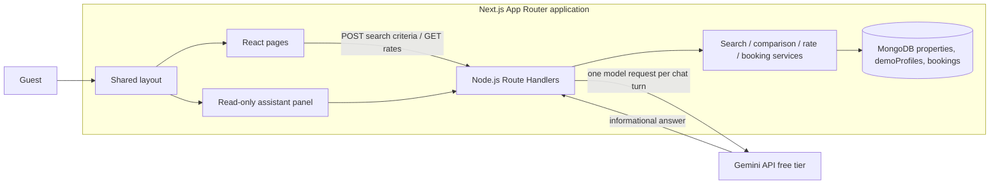

# Architecture: Standalone Hotel Booking Assistant

## 1. Goals and boundaries

Build a reusable, fictional hotel booking site with a page-aware, read-only assistant. Use **Next.js App Router, React, and TypeScript** for the site and backend routes; **MongoDB** for synthetic property data and mock bookings; and **Gemini API free tier** for natural-language answers. Do not connect to Marriott systems, production data, payment services, or paid AI services.

The guest journey is Home → Search Results → Rate List Menu (RLM) → Checkout → Confirmation. A visible demo profile selector lets the guest choose which fictional account informs profile-aware suggestions. The assistant helps explain and compare current-page information. It never sets search fields, applies filters, selects a property/room/rate, or submits a booking. The guest uses regular page controls for all actions.

## 2. Routing and application structure

Use the Next.js **App Router**. Next.js is a React framework with file-based routes and shared layouts. Suggested routes:

```text
app/
  layout.tsx                         # root document and global providers
  page.tsx                           # Home
  search/page.tsx                    # Search Results
  property/[propertyId]/rates/page.tsx # RLM
  checkout/page.tsx                  # Checkout
  confirmation/[code]/page.tsx       # Confirmation
  api/v1/assistant/turn/route.ts     # One assistant turn
  api/v1/searches/route.ts           # Synthetic search
  api/v1/properties/[id]/rates/route.ts
  api/v1/bookings/route.ts           # Mock booking
  api/v1/bookings/[code]/route.ts    # Mock confirmation lookup
  api/v1/demo-profiles/route.ts      # List synthetic demo profiles
  api/v1/demo-profiles/[profileId]/route.ts # Read one synthetic profile
```

The shared layout can keep the assistant launcher/sidebar visible while routes change. Since shared layouts persist between navigations, the client assistant component must detect a route change, create a new `pageSessionId`, clear messages and pending UI state, and show prompts for the new page. Booking selections live in separate site state and may persist across routes as needed.

See the [Next.js App Router documentation](https://nextjs.org/docs/app) and [layouts and pages guide](https://nextjs.org/docs/app/getting-started/layouts-and-pages).

## 3. Runtime architecture



Next.js Route Handlers run on the Node.js server and provide the backend. There is no separate Express service or AI agent framework required. The Gemini API key remains in server-only environment configuration.

Search Results and the Rate List Menu contain presentation and form state only: they call the search/rates Route Handlers and render typed responses. Those handlers read the active synthetic property documents from MongoDB. The Rates handler and booking submission share a server-side quote calculation, so browser-submitted totals are never trusted. Backend AI grounding is deferred to V3.

## 3.1 Frontend component architecture: Atomic Design

Organize reusable presentation components using the Atomic Design hierarchy: **atoms → molecules → organisms → templates/pages**. Keep booking logic and data access in feature hooks/services rather than inside generic visual components.

```text
src/components/
  atoms/          Button, Text, TextField, Select, Badge, Icon, Spinner
  molecules/      FormField, DateRangeField, GuestCountField, PromptChip,
                  ChatMessage, AmenityList, PriceBreakdown
  organisms/      SiteHeader, DemoProfileSelector, HotelSearchForm, AssistantPanel,
                  PropertyResultsList, RateOptionsList, CheckoutSummary,
                  ConfirmationSummary
  templates/      BookingPageLayout, SearchPageTemplate, CheckoutPageTemplate
src/features/
  booking/        page-specific forms, state, hooks, and orchestration
  assistant/      page session, transcript state, prompt sets, API client
```

Classification guideline: an **atom** is a small UI primitive with no booking knowledge; a **molecule** combines primitives into one focused control or display; an **organism** is a complete section with a clear responsibility; a **template** defines page layout and slots; a Next.js **page** supplies route-specific data and composes organisms into a template.

Example: `TextField` (atom) + `FormField` (molecule) + `HotelSearchForm` (organism) + `SearchPageTemplate` (template) + `app/search/page.tsx` (route page).

Prefer composition and props over page-specific forks of common components. Keep component APIs small and typed; do not make atoms call APIs, access MongoDB, or contain Gemini prompts.

## 4. Single-request assistant design

For each user message:

1. Browser sends one `POST /api/v1/assistant/turn` request with the current page, a new page-scoped session ID, selected synthetic `profileId`, current-page chat history, message, and compact synthetic page context.
2. The Route Handler validates the request, resolves the profile ID from MongoDB, includes only preferences and illustrative reward values, strips contact/profile fields from page context, and bounds message/history/context sizes.
3. The Route Handler sends one prompt to Gemini Interactions with `store: false` and no tools; the server-only API key stays in the request header.
4. The server validates the returned text and sends an informational response to React.

No Gemini function calling, agent loop, MCP server, browser-facing data-tool calls, or extra paid libraries are used. The model does not decide whether to call an API. Current Search/Rates assistant context is a limitation message only; Mongo-backed grounding is planned for V3. Checkout/Confirmation may send their current mock snapshot context, plus the selected profile's server-resolved synthetic preferences/rewards.

The browser makes one assistant API request per chat turn. The backend makes one Gemini request per turn. Search, rate, and booking routes are separate normal site API requests and are not initiated by assistant answers.

## 5. Read-only assistant scope

The assistant can:

- Explain Home search fields and current Checkout/Confirmation details when present in the page context.
- Provide generic help on Search Results and RLM; property/rate comparisons require the V3 backend-grounding slice.
- Help the guest understand differences and tradeoffs using only facts supplied for the current page.
- Ask a clarifying question in chat if the guest's question is ambiguous.
- Provide suggested questions as chips.

The assistant cannot:

- Edit form fields, run a search, apply filters, navigate for the guest, or change page selections.
- Select a property, room, or rate; create an executable action proposal; or submit a booking.
- Call arbitrary tools, URLs, databases, or services.

The normal page components remain responsible for all search and selection actions. Checkout calls the mock booking endpoint only after the guest submits the standard form.

## 6. Current-page context contract

Send a compact object built from synthetic content currently shown on the page. Do not send the complete app store, guest contact/profile details, hidden page content, or another route's context. The endpoint recursively removes contact/profile fields and rejects contexts larger than 8,000 serialized characters. Context is prompt data only; it cannot authorize a booking or selection.

## 7. Application modules

```text
app/                       Next.js pages, layouts, and Route Handlers
src/components/            reusable React UI, including assistant panel
src/features/booking/      booking state and page-specific behavior
src/features/assistant/    types, page session reset, transcript UI, prompt chips
src/server/ai/              Gemini API client and response validation
src/server/services/        search, rates, property comparison, mock booking
src/server/mongo/           server-only MongoDB client and database access
src/server/repositories/    MongoDB property, demo-profile, and booking repositories
src/shared/schemas/         shared request/response validation schemas
src/data/seed/              synthetic property and demo-profile seed documents
scripts/seed-mongodb.mjs    repeatable fixture upsert and index setup
```

Route Handlers validate input, call one service, map errors to API responses, and do not contain prompt/business logic inline. Services and repositories are ordinary deterministic code, not model-triggered tools.

## 8. Workspace tooling decision

Use one conventional Next.js application in this repository for the initial implementation. The frontend and Node.js Route Handlers are parts of the same application, so an Nx workspace with separately managed apps and libraries would add tooling without creating a needed app or package boundary. Keep the code modular inside the app using the structure above. Revisit Nx if the project grows into separate deployable web/API apps, independently versioned shared packages, or CI workloads that benefit from workspace task orchestration and affected-project builds.

## 9. Booking and assistant state

| State | Owner | Lifetime |
|---|---|---|
| Destination, dates, guests | Booking form/store | Retained in browser state; send criteria with every rate and booking request |
| Selected property, room, rate | Normal page controls/store | Retained through checkout |
| Selected demo profile ID | Booking/site state | Retained across routes; changing it changes checkout contact defaults and profile-aware assistant context |
| Assistant transcript | Assistant component | Current route/page session only; cleared at route change |
| Current-page assistant context | Route Handler request | One assistant turn |
| Catalog | MongoDB `properties` collection | Read-only synthetic data |
| Demo profiles | MongoDB `demoProfiles` collection | Seeded fictional contact, preference, and Juniper demo rewards |
| Mock booking | MongoDB `bookings` collection | Persisted mock confirmation linked to profile with contact snapshot |

Do not persist chat history in the database. Do not attach page chats together by a journey ID. New route means new `pageSessionId` and an empty transcript. Keeping booking state for page navigation is solely a site requirement, not conversational memory.

## 10. Gemini integration and cost behavior

- Use a model currently available on Gemini API free tier; keep its model ID in server configuration.
- Make one model request per assistant turn. Do not use function calling or built-in paid/search tools in this version.
- Keep the API key server-side and out of `NEXT_PUBLIC_*` variables, client bundles, screenshots, and source control.
- Bound message length, history length, and page context size to manage free-tier request limits.
- If Gemini returns a quota, timeout, or temporary provider error, show its fallback and a Retry action; if setup is invalid, show guidance without a Retry action. Search and booking pages remain functional.
- Send synthetic fixture data only. Google may use free-tier input/output data to improve products; never send real customer or reservation information.

## 11. Errors and resilience

- Gemini timeout/quota: return a typed assistant error; normal page controls continue working.
- Unsupported facts: answer from either current-page data or the server-resolved, allowlisted synthetic profile facts. Use the cannot-confirm fallback only when the detail is absent from both sources; do not invent an answer.
- Unknown IDs: return `NOT_FOUND`; do not ask the model to invent values.
- Empty result set: return an empty result state with normal form controls for the guest to change criteria.
- Mock booking failure: do not show a confirmation; display an error and keep checkout values for retry.
- Malformed model response: validate, discard invalid structure, and return a safe fallback.

## 12. Future extension boundary

If a later version needs live data or actions, add explicit service APIs and human-reviewed action flows as a separate design decision. Do not quietly introduce Gemini function calling, booking selection tools, or production connections into this read-only version.
