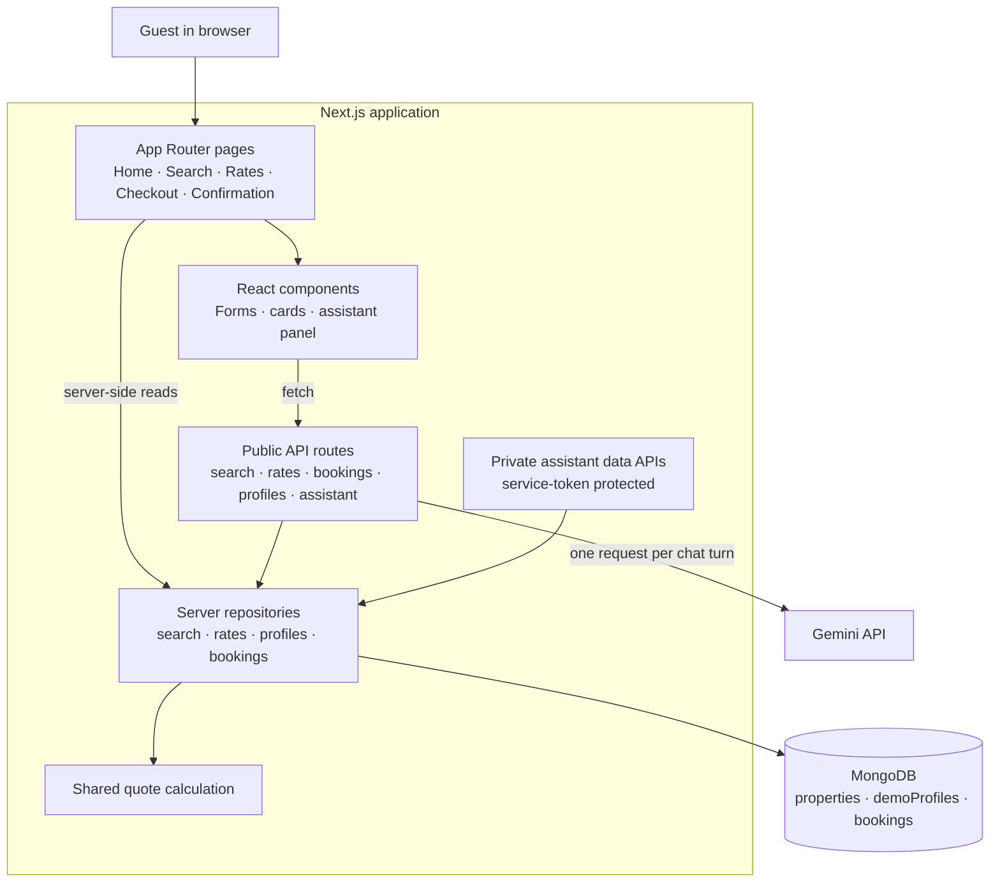

# Code Architecture: A Guide to This Project

This guide describes the code that is in the repository today. It is intended as a starting point for someone new to the project; the more detailed [architecture](./architecture.md), [system design](./system-design.md), [API design](./api-design.md), and [database design](./database-design.md) documents provide additional detail.

## What this project is

This is a fictional hotel-booking demo called **dreRuss Hotels**. It is a single Next.js application that serves both the website and its backend API routes. The app uses synthetic hotel and guest-profile data, MongoDB for property data and mock bookings, and an optional Gemini API integration for a read-only chat assistant.

It is not connected to Marriott systems, real hotel inventory, real customer accounts, payment processing, or reservation systems. A successful checkout creates only a demo record.

## Big picture



The browser renders the pages and interactive components. Next.js route handlers and server-rendered pages run on the server. Server repositories own MongoDB reads and writes, and shared pricing code calculates synthetic quotes. The assistant is currently a direct, single-request Gemini integration in this Next.js app; the separate LangGraph orchestration service described in the V3 design is future work, not a running component.

## Guest journey

| Page | Route | What happens |
|---|---|---|
| Home | `/` | Shows a featured fictional property and a search form. Featured content and initial criteria come from local fixtures. |
| Search results | `/search` | Reads search criteria from the URL. The results component fetches the search API. The visible filter controls are examples and are not connected to filtering yet. |
| Rate List Menu (RLM) | `/property/[propertyId]/rates` | Reads property and stay criteria from the URL. The rates component fetches room and rate details. |
| Checkout | `/checkout` | Reads the selected property, room, rate, and stay from the URL, reloads the canonical rate data on the server, and shows a review before the guest submits. |
| Confirmation | `/confirmation/[code]` | Loads the saved mock booking by confirmation code and displays its stored snapshot. |

Search criteria and selections are carried between pages using URL parameters. The selected demo profile is held in shared client-side profile context and saved in browser local storage. The assistant drawer is shared through the root layout; its conversation is reset when the page path or selected profile changes.

## How a request moves through the code

### Search and rates

1. A page or component collects guest input.
2. The browser requests `POST /api/v1/searches` or `GET /api/v1/properties/[propertyId]/rates`.
3. The route handler checks the request and returns JSON.
4. It calls a server-only repository, which reads the `properties` MongoDB collection.
5. Repository code maps database documents into the shared response types. The rates repository uses the shared quote calculator to calculate stay totals.
6. The React component renders the response.

### Mock checkout

1. Checkout reloads the chosen property, room, and rate from MongoDB; it does not rely on a price submitted by the browser.
2. The guest submits the standard checkout form, which calls `POST /api/v1/bookings` with the selection, stay criteria, demo profile, and an idempotency key.
3. The route validates the request, reloads the selected profile and rate, checks room/adult limits, and constructs a booking snapshot.
4. The bookings repository saves the snapshot in the `bookings` collection.
5. The confirmation page looks up that record using `GET /api/v1/bookings/[confirmationCode]`.

The booking API uses the idempotency key to avoid creating duplicate demo records for a repeated submission. No payment is requested or processed.

### Assistant

The assistant panel posts each turn to `POST /api/v1/assistant/turn`. That route validates and limits message, history, and page context; removes or excludes private-looking context fields; loads the selected synthetic profile from MongoDB; and sends one request to Gemini. The Gemini key is read from server-side environment configuration.

The assistant is intended to explain, not operate the booking flow. It cannot change search criteria, select a room or rate, or submit checkout. Home and the result/rate pages have limited context; current search and rate grounding through the private assistant APIs has not yet been connected to the drawer. Checkout and confirmation provide a current-page summary. The model request uses `store: false` and should receive synthetic demo information only.

The `app/internal/v1/assistant/*` routes are a separate set of private, read-only data APIs protected by `AI_SERVICE_TOKEN`. They provide search, property details, rates, checkout summary, and attribute metadata for a future assistant service integration. They do not call the model themselves and are not currently invoked by the browser assistant.

## Where to look in the repository

| Location | Responsibility |
|---|---|
| `app/` | URL routes, server-rendered pages, and API route handlers. |
| `app/api/v1/` | Public app APIs used by the website, including search, rates, booking, profiles, and the assistant turn. |
| `app/internal/v1/assistant/` | Service-token-protected, read-only assistant data endpoints. |
| `src/components/atoms/` | Small, reusable UI building blocks such as buttons and badges. |
| `src/components/molecules/` | Composed controls, such as profile selection and form fields. |
| `src/components/organisms/` | Larger page sections, such as search forms, results, rate panels, checkout, and assistant UI. |
| `src/components/templates/` | Shared page framing and layout composition. |
| `src/features/` | Feature-level UI state and helpers. Booking helpers live under `booking/`; profile and assistant UI state live under their respective folders. |
| `src/server/mongo/` | Server-only MongoDB connection. |
| `src/server/repositories/` | Database access and mapping into app-facing data types. |
| `src/server/pricing/` | Deterministic stay length and quote calculations, shared by rate and booking flows. |
| `src/server/assistant/` | Assistant request validation, internal API authorization, and the attribute catalog. |
| `src/shared/types.ts` | Shared TypeScript types for properties, rates, search, profiles, and confirmations. |
| `src/data/` | Local UI fixtures and seed data. |
| `scripts/seed-mongodb.mjs` | Loads the synthetic property and profile seed records into the configured MongoDB database and creates indexes. |
| `docs/` | Product requirements, system and API designs, database documentation, project status, and this code guide. |

`import "server-only"` in MongoDB/repository modules helps keep database code out of browser bundles. UI components should call APIs rather than importing server repositories.

## API map

### Website APIs

| Method and path | Purpose |
|---|---|
| `POST /api/v1/searches` | Validate criteria and return a page of synthetic property results. |
| `GET /api/v1/properties/[propertyId]/rates` | Return the property's rooms, rates, and calculated stay quote. |
| `POST /api/v1/bookings` | Create or return an idempotent mock booking. |
| `GET /api/v1/bookings/[confirmationCode]` | Read a mock booking confirmation. |
| `GET /api/v1/demo-profiles` | List demo profiles. |
| `GET /api/v1/demo-profiles/[profileId]` | Read one demo profile. |
| `POST /api/v1/assistant/turn` | Get a read-only response from Gemini for one page-scoped assistant turn. |

### Private assistant data APIs

These endpoints require a server-to-server bearer token and are not browser-facing:

| Method and path | Purpose |
|---|---|
| `GET /internal/v1/assistant/attribute-catalog` | Describe the assistant's supported data attributes and operations. |
| `POST /internal/v1/assistant/properties/search` | Search synthetic properties using registered filters/sort fields. |
| `POST /internal/v1/assistant/properties/details` | Read registered facts for one or more in-scope properties. |
| `GET /internal/v1/assistant/properties/[propertyId]/rates` | Read room and rate details for one property and stay. |
| `POST /internal/v1/assistant/checkout-summary` | Read the current selected stay and quote summary. |

API contracts and validation/error details are documented in [API design](./api-design.md).

## Data and database

The application uses one configured MongoDB database (defaults to `juniper_hotels_demo` if `MONGODB_DATABASE` is unset):

| Collection | Contents |
|---|---|
| `properties` | Synthetic property, room, rate, and assistant attribute data. |
| `demoProfiles` | Synthetic guest profile records used by server profile lookups. |
| `bookings` | Mock confirmation snapshots created by checkout. |

Seed files live in `src/data/seed/`. `npm run seed:db` upserts properties and profiles and creates the required indexes; it does not clear or rewrite existing booking records. The on-screen profile choices are loaded from the checked-in profile fixture, while server APIs resolve a selected profile against MongoDB.

Prices are recalculated from the stored nightly price, tax, fee, dates, and room count. The browser is not the authority for a booking total. See [database design](./database-design.md) for collection details and indexes.

## Run the project

Requirements and full setup are in the [README](../README.md). In brief:

```bash
npm install
cp .env.example .env.local
# Configure a non-production MONGODB_URI and MONGODB_DATABASE.
# GEMINI_API_KEY and AI_SERVICE_TOKEN are server-only configuration.
npm run seed:db
npm run dev
```

The UI can be browsed without Gemini, but assistant replies need `GEMINI_API_KEY`. Private assistant data APIs need `AI_SERVICE_TOKEN`. Keep both values server-side; do not put them in `NEXT_PUBLIC_*` variables or documentation.

Useful checks:

```bash
npm run typecheck
npm run build
```

## Current implementation versus design documents

The source code is the record of what currently runs. Some design documents describe intended or future behavior:

- The regular booking and search flow is implemented as a single Next.js app with MongoDB-backed repositories.
- The browser assistant currently makes one direct Gemini request per turn and does not use function calling or a graph.
- The private assistant data endpoints are implemented, but the assistant panel does not call them yet.
- [V3 system design](./system-design-v3.md) describes a proposed separate LangGraph service and grounded assistant workflow. Treat it as a target design, not as deployed architecture.
- Search-results filter controls are currently presentation-only.

When implementation and a design document disagree, check the relevant route/component code and update the status/design docs as part of the related feature work.
