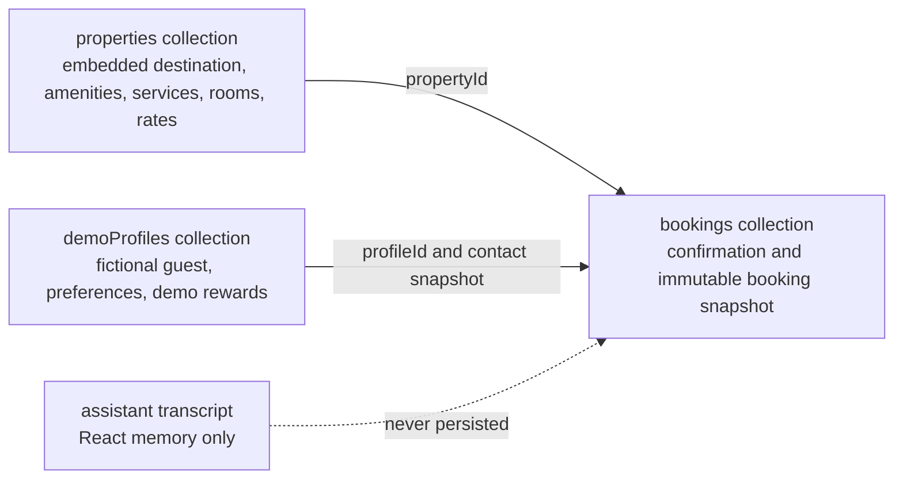

# Database Design: MongoDB

## 1. Scope and choice

Use MongoDB for the fictional booking site's synthetic catalog, demo guest profiles, and mock confirmations. The React/Next.js app reads seeded hotel/profile documents, and the Node.js Route Handlers create/read mock booking documents. Never store production data, real guest profiles, real loyalty data, payment data, or assistant conversations.

For a no-cost hackathon environment, MongoDB Atlas currently offers a Free cluster with limited capacity (512 MB storage and operational limits). A small seeded catalog should fit. Check current [Atlas Free cluster limits](https://www.mongodb.com/docs/atlas/reference/free-shared-limitations/) during setup. MongoDB Community Server can also run locally if the team prefers not to use a hosted database.

## 2. Modeling approach

MongoDB documents fit the demo's read pattern: Search Results, RLM, and property questions often need related property, amenity, room, and rate data together. Keep these bounded, mostly read-only child records embedded in a property document. MongoDB's [embedded data model](https://www.mongodb.com/docs/manual/data-modeling/embedding/) supports retrieving related subdocuments together.

Use three collections for the initial flow:

1. **`properties`**: fictional property content, amenities, facilities, room types, rate plans, and simple demo availability/pricing.
2. **`bookings`**: successful mock bookings with a snapshot of the selected property, room, rate terms, and totals.
3. **`demoProfiles`**: seeded fictional guests with demo contact details, preferences, and clearly illustrative Juniper Rewards values.

Search criteria remain in the booking state in the browser. The assistant transcript remains in the current page session and is cleared on route change. Neither requires a MongoDB collection in this project.

The checked-in seed contains 83 fictional properties: 50 in New York plus the original three Irving properties and ten each in Chicago, Los Angeles, and San Francisco. Re-running `npm run seed:db` upserts these documents into `properties`; it does not clear bookings. Search uses the indexed `destination.cityNormalized` and `active` fields and returns a page of compact property-card fields. Rate plans remain embedded in each property document but are not returned by Search.

## 3. Entity relationship view



## 4. `properties` document

Example document:

```json
{
  "_id": "PROP-014",
  "slug": "harborlight-sample-city",
  "name": "Harborlight Hotel",
  "summary": "A fictional hotel near the waterfront.",
  "destination": {
    "id": "DEST-001",
    "city": "Sample City",
    "cityNormalized": "sample city",
    "region": "Sample Region",
    "countryCode": "US"
  },
  "address": {
    "line1": "100 Example Quay",
    "postalCode": "00001"
  },
  "rating": 4.3,
  "amenities": [
    { "id": "POOL", "name": "Indoor pool", "category": "recreation" },
    { "id": "GYM", "name": "Fitness room", "category": "wellness" }
  ],
  "services": [
    {
      "id": "SPA",
      "name": "Sample Spa",
      "description": "A fictional spa service.",
      "openingHours": "09:00-20:00",
      "price": { "amount": "45.00", "currency": "USD" }
    }
  ],
  "roomTypes": [
    {
      "id": "ROOM-DELUXE",
      "name": "Deluxe King",
      "description": "One king bed with a city view.",
      "maxAdults": 2,
      "maxChildren": 1,
      "bedSummary": "1 king bed",
      "ratePlans": [
        {
          "id": "RATE-FLEX",
          "name": "Flexible Rate",
          "refundable": true,
          "cancellationSummary": "Free cancellation until 6 PM two days before arrival.",
          "paymentSummary": "Pay at the property.",
          "nightlyRate": { "amount": "209.00", "currency": "USD" },
          "taxPercent": "10",
          "feesPerNight": { "amount": "5.00", "currency": "USD" },
          "demoAvailableRooms": 4
        },
        {
          "id": "RATE-SAVER",
          "name": "Advance Saver",
          "refundable": false,
          "cancellationSummary": "Non-refundable after booking.",
          "paymentSummary": "Pay in advance.",
          "nightlyRate": { "amount": "179.00", "currency": "USD" },
          "taxPercent": "10",
          "feesPerNight": { "amount": "5.00", "currency": "USD" },
          "demoAvailableRooms": 3
        }
      ]
    }
  ],
  "active": true,
  "updatedAt": "2026-11-16T00:00:00.000Z"
}
```

`demoAvailableRooms` is static mock availability, not date-specific inventory. The Rates API calculates a quote from the guest's dates, room count, nightly rate, tax percentage, and per-night fee. The booking endpoint re-reads MongoDB and uses the same calculation before saving a price snapshot. Label availability and prices as synthetic; do not present them as live or guaranteed.

### Property validation rules

- `slug` is unique.
- `rating` is between 0 and 5.
- Nested IDs (`amenities.id`, `services.id`, `roomTypes.id`, `ratePlans.id`) are unique within their parent document.
- Prices are stored as decimal strings in JSON and converted to a decimal-safe type in Node.js. Avoid JavaScript floating-point arithmetic for money.
- `taxPercent` is stored as a decimal string so the backend can calculate totals with integer minor units rather than binary floating-point money arithmetic.
- Keep embedded arrays bounded and curated. If a property's inventory/history grows substantially, move those records to a separate collection.

## 5. `bookings` document

Create a booking document only when the guest submits the regular Checkout form. Store a stable snapshot so the confirmation remains understandable if the property's demo fixture changes later.

```json
{
  "_id": "BOOKING-001",
  "confirmationCode": "DEMO-7F4K2Q",
  "idempotencyKey": "checkout-submit-opaque-id",
  "requestHash": "sha256-of-normalized-selection-and-profile-snapshot",
  "status": "confirmed",
  "demo": true,
  "profileId": "PROFILE-ALEX",
  "profile": { "id": "PROFILE-ALEX", "displayName": "Alex Sample" },
  "guestContact": {
    "name": "Alex Sample",
    "email": "alex@example.test"
  },
  "property": {
    "id": "PROP-014",
    "name": "Harborlight Hotel"
  },
  "stay": {
    "checkIn": "2027-04-10",
    "checkOut": "2027-04-13",
    "adults": 2,
    "children": 0,
    "rooms": 1,
    "nights": 3
  },
  "selection": {
    "roomId": "ROOM-DELUXE",
    "roomName": "Deluxe King",
    "rateId": "RATE-FLEX",
    "rateName": "Flexible Rate",
    "cancellationSummary": "Free cancellation until 6 PM two days before arrival.",
    "paymentSummary": "Pay at the property."
  },
  "priceSnapshot": {
    "subtotal": { "amount": "627.00", "currency": "USD" },
    "taxesAndFees": { "amount": "77.70", "currency": "USD" },
    "total": { "amount": "704.70", "currency": "USD" },
    "priceBasis": { "rooms": 1, "nights": 3 }
  },
  "createdAt": "2026-11-16T10:00:00.000Z"
}
```

Each mock booking links to the selected `demoProfiles` record and stores a checkout contact snapshot copied from that seeded profile (fictional name and `.test` email) so its confirmation remains self-contained. Checkout displays this demo contact data and does not ask guests to enter real personal information. Do not store street address, payment details, real loyalty identifiers, or real personal data. Demo reward data belongs only to `demoProfiles` and is not a claim about any real program.

## 6. `demoProfiles` document

Profiles are seeded fixtures selected through a visible demo profile picker. This is not authentication or authorization.

```json
{
  "_id": "PROFILE-ALEX",
  "displayName": "Alex Sample",
  "email": "alex@example.test",
  "preferences": ["quiet room", "late checkout"],
  "rewards": {
    "programName": "Juniper Rewards (demo)",
    "tier": "Gold (demo)",
    "pointsBalance": 12400,
    "upgradeAwardsAvailable": 1
  },
  "demo": true
}
```

Seed a small set of fictional profiles with distinct preferences/reward values to make profile switching observable. Keep benefit eligibility and any earning examples in explicit fixture rules; do not infer real program rules. The assistant may explain only the selected profile's seeded values and must call them illustrative demo rewards.

## 7. Indexes

Create indexes during seed/bootstrap:

```js
db.properties.createIndex({ slug: 1 }, { unique: true });
db.properties.createIndex({ "destination.cityNormalized": 1, active: 1 });
db.properties.createIndex({ "amenities.id": 1, active: 1 });
db.demoProfiles.createIndex({ email: 1 }, { unique: true });
db.bookings.createIndex({ confirmationCode: 1 }, { unique: true });
db.bookings.createIndex({ idempotencyKey: 1 }, { unique: true });
db.bookings.createIndex({ createdAt: -1 });
db.bookings.createIndex({ profileId: 1, createdAt: -1 });
```

Unique indexes prevent duplicate slugs, confirmation codes, and duplicate checkout submissions. MongoDB supports unique single-field and compound indexes; see [unique indexes](https://www.mongodb.com/docs/manual/core/index-unique/). Index only fields used by the simple destination, amenity, slug, and confirmation lookups.

When filtering nested arrays on multiple fields, use `$elemMatch` so room and rate constraints apply to the same embedded element.

## 8. Read/write patterns

### Search Results

- Query active properties by the indexed `destination.cityNormalized` field and `active: true`.
- Return a compact card projection; do not send the complete embedded room/rate catalog to the browser unless needed.
- The current `POST /api/v1/searches` request uses the destination string and stateless criteria documented in `api-design.md`; no search record or `searchId` is created.
- For amenity arrays, use the multikey index on `amenities.id`.

### RLM

- Fetch one active property by `_id` and project its summary, `roomTypes`, and their `ratePlans`.
- Validate stay criteria server-side and compute per-room nightly entries plus room/night-specific subtotal, taxes, fees, and total using integer minor units.
- Search and Rates UIs render API responses; do not import property, room, or rate fixtures into these components. Assistant grounding from current Search/Rates Mongo records is deferred to V3; until then, it must not use stale local property/rate fixtures.

### Checkout and confirmation

- On checkout submission, re-read the selected property/room/rate and validate IDs, guest capacity, and mock availability.
- Calculate the final price on the server.
- Insert one booking snapshot. Reuse a prior booking for a repeated `idempotencyKey` instead of creating a duplicate.
- Validate the selected `profileId` against `demoProfiles`; store the profile ID and a snapshot of the synthetic checkout name/email on the booking.
- Confirmation lookup queries by `confirmationCode` and returns only the demo snapshot.

### Demo profiles

- The profile selector reads the small seeded `demoProfiles` collection and displays the active profile name.
- Keep the selected profile ID in site booking state across routes. Send only the selected profile ID (not the whole profile record) when an assistant turn needs profile-aware suggestions; the server resolves the allowed preferences/reward facts.
- Never trust client-submitted reward balances or eligibility. Resolve profile facts from MongoDB.

## 9. Chat data handling

There is no `conversations` or `messages` collection. The current page's transcript is held in the React assistant component and sent only with that page's assistant turn. On route navigation, the client clears it and creates a new `pageSessionId`. Booking state persists separately in the app as required to complete the stay.

## 10. Seed and environment setup

- Do not persist raw search destination text in mock bookings. Search criteria remain browser navigation state; the booking snapshot stores dates and guest/room counts only.
- Keep synthetic property and demo-profile seed data in `src/data/seed/properties.json` and `src/data/seed/demo-profiles.json`; run `npm run seed:db` with `MONGODB_URI` set to upsert both collections by `_id` and create indexes.
- The application and `npm run seed:db` read the ignored local `.env.local` file; the seed script uses Node's `--env-file` option. Keep `MONGODB_URI` server-side and never expose it through a `NEXT_PUBLIC_*` variable or commit it.
- Restrict Atlas network access and credentials to the hackathon project; use no production credentials.
- Provide an `.env.example` containing placeholders only.
- No reset script is included. Reseeding is idempotent for the synthetic `properties` and `demoProfiles` collections and does not delete mock bookings; keep all seed operations in a dedicated non-production database.

## 11. Collection growth boundary

The `requestHash` is an internal idempotency safeguard: repeated submissions with the same key and same normalized booking return the existing record; a key reused for different details is rejected. This three-collection model is deliberately small. If later needs include date-specific inventory, multiple currencies, large amenity catalogs, or production-scale booking data, introduce dedicated collections (for example, `rateAvailability`) and review the data model then. Do not add these systems to the current scope.
