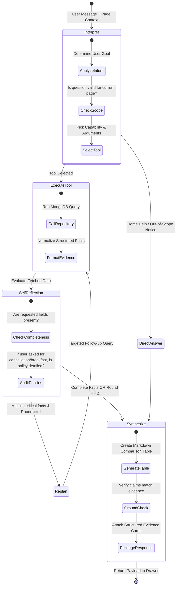

# System Design: V3 Unified LangGraph Assistant Orchestrator

**Product:** dreRuss Hotels booking experience  
**Version:** V3  
**Status:** Approved for Implementation  
**Last updated:** 2026-11-19  

---

## 1. System Architecture Overview

The architecture is divided into three distinct major blocks: **Frontend (User Side)**, the **AI Layer (In the Middle)**, and the **Backend & Database**.

```mermaid
flowchart LR
    classDef feBox fill:#e1f5fe,stroke:#0288d1,stroke-width:2px;
    classDef aiBox fill:#fff3e0,stroke:#f57c00,stroke-width:2px;
    classDef beBox fill:#e8f5e9,stroke:#388e3c,stroke-width:2px;
    classDef nodeStyle fill:#ffffff,stroke:#37474f,stroke-width:1px;

    %% =========================================================================
    %% BLOCK 1: FRONTEND (USER SIDE)
    %% =========================================================================
    subgraph Frontend["1. FRONTEND (User Side)"]
        direction TB
        User(["👤 Hotel Guest"])
        BookingPages["📱 Booking Pages<br/>(Home, Search, RLM, Checkout)"]
        PageContext["📌 Page Context Provider<br/>(Route, Dates, Property ID)"]
        ChatDrawer["💬 AI Assistant Drawer<br/>(Chat UI, Tables & Evidence)"]

        User --> BookingPages
        BookingPages --> PageContext
        PageContext --> ChatDrawer
    end

    %% =========================================================================
    %% BLOCK 2: AI LAYER (IN THE MIDDLE)
    %% =========================================================================
    subgraph AILayer["2. AI LAYER (Orchestration Engine)"]
        direction TB
        ApiGateway["⚡ API Route Handler<br/>(app/api/v3/assistant/turn)"]
        
        subgraph LangGraphEngine["LangGraph ReAct + Reflection Loop"]
            direction TB
            NodeInterpret["1. Interpret Node<br/>(Gemini Intent & Tool Selection)"]
            NodeAct["2. Tool Execution Node<br/>(In-Memory Function Calls)"]
            NodeReflect{"3. Self-Reflection Node<br/>(Are all facts verified?)"}
            NodeReplan["4. Re-plan Node<br/>(Target Missing Policy/Detail)"]
            NodeSynthesize["5. Synthesize Node<br/>(Markdown Table + Evidence)"]

            NodeInterpret --> NodeAct
            NodeAct --> NodeReflect
            NodeReflect -- "❌ Incomplete" --> NodeReplan
            NodeReplan --> NodeAct
            NodeReflect -- "✅ Verified" --> NodeSynthesize
        end

        ApiGateway --> NodeInterpret
        NodeSynthesize --> ApiGateway
    end

    %% =========================================================================
    %% BLOCK 3: BACKEND & DATABASE
    %% =========================================================================
    subgraph Backend["3. BACKEND & DATABASE"]
        direction TB
        subgraph Repositories["Backend Business Logic & Repositories"]
            direction TB
            PropRepo["🏨 Property Search & Details<br/>(searchAssistantProperties)"]
            RateRepo["💰 Room & Rate Quote Engine<br/>(getMongoPropertyRates)"]
            CheckoutRepo["🧾 Checkout Summary Service"]
        end

        subgraph Database["MongoDB Atlas (Data Store)"]
            direction TB
            DB_Props[("properties collection")]
            DB_Bookings[("confirmations collection")]
            DB_Profiles[("profiles collection (V4)")]
        end

        PropRepo <--> DB_Props
        RateRepo <--> DB_Props
        CheckoutRepo <--> DB_Bookings
    end

    %% =========================================================================
    %% INTER-BLOCK COMMUNICATION
    %% =========================================================================
    ChatDrawer -->|"① POST Turn Request<br/>(Message + Context)"| ApiGateway
    ApiGateway -->|"④ HTTP 200 JSON<br/>(Answer + Evidence)"| ChatDrawer

    NodeAct <-->|"② Direct In-Memory Call"| Repositories
    Repositories <-->|"③ MongoDB Queries"| Database

    class Frontend feBox;
    class AILayer aiBox;
    class Backend beBox;
    class User,BookingPages,PageContext,ChatDrawer,ApiGateway,NodeInterpret,NodeAct,NodeReflect,NodeReplan,NodeSynthesize,PropRepo,RateRepo,CheckoutRepo,DB_Props,DB_Bookings,DB_Profiles nodeStyle;
```



---

## 2. Data & API Sufficiency Analysis

### Are existing MongoDB schemas and backend APIs sufficient?
**Yes, 100% sufficient for V3.**

1. **`properties` Collection:**
   * Contains hotel metadata, city locations, star ratings, full amenities (pool, pet policies, fitness center, breakfast lounge), room types (Deluxe King, Executive Suite), and base rate packages.
   * Fully powers `searchProperties`, `getPropertyDetails`, and `getRoomRates`.
2. **`confirmations` Collection:**
   * Stores mock booking records, confirmation codes, and snapshots of totals and guest names.
   * Powers `getCheckoutSummary`.
3. **`profiles` Collection:**
   * Contains demo profiles (`Alex - Silver Elite`, `Jordan - Platinum Elite`, etc.).
   * Held reserved for **V4 Upselling**; not required for V3 core assistant operations.

No schema migrations or new database collections are required for V3.

---

## 3. Approved Tool Capability Registry

The LangGraph agent is granted access to four strictly scoped, read-only tools:

| Tool Name | Allowed Page Scope | Description & Arguments | Backend Target |
| :--- | :--- | :--- | :--- |
| `searchProperties` | `search-results` | Searches the full property database by city, stay dates, and filters (e.g. amenities, maximum price, sorting). | `searchAssistantProperties()` |
| `getPropertyDetails` | `search-results`, `rate-list` | Retrieves comprehensive facts for one or more hotel IDs (amenities, check-in/out policies, location notes). | `getAssistantPropertyDetails()` |
| `getRoomRates` | `rate-list` | Retrieves all available rooms, rate plans, breakfast inclusions, and cancellation terms for the selected hotel and stay dates. | `getMongoPropertyRates()` |
| `getCheckoutSummary` | `checkout` | Retrieves accurate price calculation (subtotal, taxes, fees) and policy summary for the selected checkout item. | Internal checkout service |

---

## 4. LangGraph State Machine & ReAct Loop



### Self-Reflection & Verification Logic
When `getRoomRates` returns room packages, rates often have brief summaries. If the user query specifically asks:
* *"Is cancellation free?"*
* *"What is the cancellation penalty?"*
* *"Is breakfast included in the package?"*

The **Self-Reflection Node** inspects `accumulatedData`:
1. If the rate package lacks specific cancellation cutoff hours or fee amounts, it flags `missingPolicy = true`.
2. It transitions to **Replan**, which selects `getPropertyDetails` to retrieve the property's canonical cancellation policy.
3. In Round 2, the evidence is merged, passing verification and routing to **Synthesize**.
4. A hard cap of **2 retrieval rounds** ensures the agent never enters an infinite loop and maintains sub-3-second responses.

---

## 5. Response Contract with Frontend

The route handler returns a structured payload matching the exact interface expected by `src/components/organisms/assistant-panel.tsx`:

```typescript
interface AssistantResponse {
  requestId: string;
  pageSessionId: string;
  status: "complete" | "incomplete" | "needs_clarification" | "out_of_scope" | "service_error";
  answer: {
    text: string; // Markdown formatted with tables and recommendations
  };
  evidence: Array<{
    status: string;
    data: unknown;
  }>;
  matches?: {
    total: number;
    items: Array<{
      name: string;
      facts: Array<{
        attribute: string;
        value: string | number | boolean;
        label?: string;
        unit?: string;
        basis?: string;
      }>;
    }>;
  };
}
```

---

## 6. Bridge to V4: Post-Booking Upselling

The V3 architecture is deliberately designed so V4 can plug in without rewriting the agent:
* In V4, on `/confirmation/[code]`, a new tool `getUpsellRecommendations({ propertyId, profileId })` will be enabled.
* The agent will cross-reference the booked property's amenities (e.g. on-site Spa, Dining, Events) with the guest's profile tier (e.g. Silver Elite).
* It will recommend personalized upgrades (e.g. *"Upgrade to Gold Elite with 3 more nights or add our Rooftop Spa package for 20% off"*).
* Keeping this segregated ensures V3 focuses 100% on high-quality search, rate comparison, and checkout assistance today.
