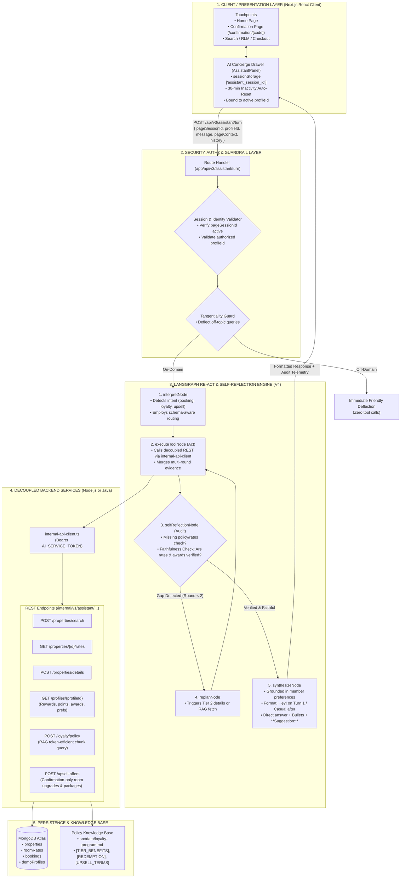
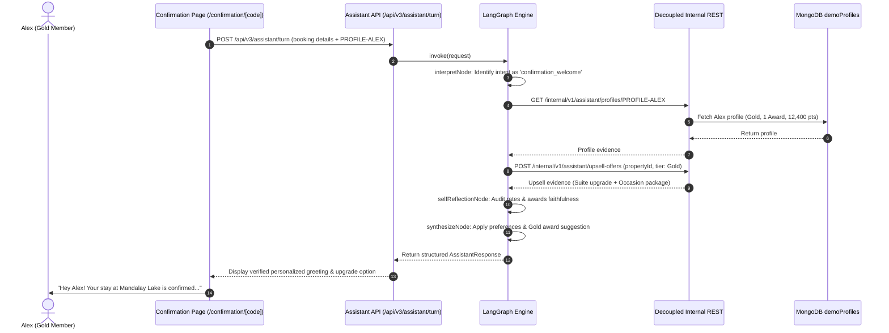

# System Design — V4.0: Loyalty Personalization, Upselling Engine & Enterprise Guardrails

**Document:** System Design Document  
**Version:** 4.0  
**Status:** Approved  
**Author:** dreRuss Engineering  
**Date:** 2026-11-20  
**Refers to:** [docs/prd-v4.md](file:///Users/jadkumar/Documents/antigravity/AI_stuff_marriott/docs/prd-v4.md)

---

## 1. High-Level System Architecture

V4 builds directly on the decoupled REST architecture established in V3.5, introducing four enterprise-grade subsystems:
1. **Client Session & Token Linkage Layer** (session lifetime & user binding).
2. **Knowledge Retrieval Layer (Lightweight RAG Engine)**.
3. **Enterprise Guardrails & Telemetry Subsystem** (tangentiality & faithfulness checks).
4. **Contextual Upsell & Profile Personalization Engine**.



---

## 2. Component Design & Deep Dive

### 2.1 Client Session & Token Linkage
1. **Lifecycle Management:**
   * On mount, `AssistantPanel` reads `sessionStorage.getItem("assistant_session_id")`.
   * If absent or if `Date.now() - lastActive > 30 * 60 * 1000`, it generates `sess_${crypto.randomUUID()}` and resets chat history.
2. **Session-to-Profile Binding:**
   * When user switches profile (e.g. from Morgan to Alex in demo picker), the client detects `previousProfileId !== activeProfileId`, terminates old session, and starts a fresh isolated session.
3. **Authorization Guard in API:**
   * Requests for `getGuestProfile` are validated so that a guest can only access the `profileId` declared in the session header. Cross-profile data tampering is strictly prohibited.

---

### 2.2 Lightweight RAG Knowledge Engine

Instead of embedding heavy vector databases for static policy text, V4 implements **Domain-Tagged Markdown Chunking**:

```
src/data/loyalty-program.md
  ├── <!-- [TIER_BENEFITS] -->
  │     Silver (5 pts/₹100), Gold (5 nights, 7 pts, 5% disc), Platinum (15 nights, 10 pts, 10% disc, breakfast)
  ├── <!-- [REDEMPTION] -->
  │     ₹0.20 per point credit, blackout rules, cancellation exclusions
  └── <!-- [UPSELL_TERMS] -->
        Room upgrades (+₹1,500/night), Breakfast (+₹500/day), Airport (+₹1,200), Special Occasion (+₹2,000)
```

* **Tool:** `queryLoyaltyPolicy({ topic: "tiers" | "points" | "upgrades" })`
* **Execution:** Reads file, matches the section tag, and returns only that chunk ($\approx 100\text{ tokens}$).
* **Token Impact:** Zero extra tokens on normal booking searches; minimal tokens when policy questions are asked.

---

### 2.3 Contextual Upselling Engine (`getUpsellOffers`)
* **Strict Scope:** `allowedPages: ["confirmation"]`.
* **Input:** `{ propertyId, currentRoomId, tier }`.
* **Logic:**
  1. Inspects property features (e.g. lake view, canal, suites).
  2. Identifies higher-tier room types (Standard $\to$ Deluxe Lake Suite for +₹1,500/night).
  3. Checks guest tier privileges:
     * **Gold / Platinum:** Flags `perkBadge: "Eligible for Complimentary Upgrade Award"` if available awards $> 0$.
     * **Platinum:** Marks breakfast as `perkBadge: "Complimentary Platinum Benefit"`.
  4. Returns standard post-booking add-ons: Airport Transfer (+₹1,200) and Special Occasion Decor (+₹2,000).

---

### 2.4 Enterprise Guardrails & Telemetry

#### 1. Tangentiality Filter (`interpretNode`)
Checks prompt relevance against hotel booking, loyalty, and stay domains.
* If user asks off-topic queries (e.g., *"Write a Python script"*, *"Who is Napoleon?"*):
* LangGraph bypasses tool execution and directly synthesizes:
  > *"I am dreRuss Concierge, your hotel booking and loyalty assistant. I can only assist with Juniper hotels, reservations, and rewards."*

#### 2. Faithfulness & Hallucination Audit (`selfReflectionNode`)
Before synthesis:
* Regex audits the draft response or planned facts against retrieved evidence.
* If a price (e.g. "₹1,500") or percentage (e.g. "5% discount") is mentioned without corresponding DB or RAG evidence, the node flags `faithfulnessViolation: true` and strips the fabricated claim.

#### 3. Structured Audit Telemetry
At the conclusion of each turn, the orchestrator emits a structured audit record:
```json
{
  "timestamp": "2026-11-20T08:15:00Z",
  "requestId": "550e8400-e29b-41d4-a716-446655440000",
  "pageSessionId": "sess_9f8a2b3c",
  "profileId": "PROFILE-ALEX",
  "tier": "Gold (demo)",
  "page": "confirmation",
  "toolsCalled": ["getGuestProfile", "getUpsellOffers"],
  "retrievalRounds": 1,
  "faithfulnessVerified": true,
  "durationMs": 940
}
```

---

## 3. Data Flow: Confirmation Page Upselling Journey



---

## 4. Verification & Non-Functional Requirements (NFRs)

| NFR Category | Target Specification |
| :--- | :--- |
| **Response Latency** | P95 $\le 2.0\text{ seconds}$ per conversational turn |
| **Token Efficiency** | Lightweight RAG chunks limit extra input tokens to $\le 150\text{ tokens}$ |
| **Security & Privacy** | Session-bound authorization prevents cross-account profile access |
| **Reliability** | Decoupled REST routes return fallback envelopes on service timeout |
| **Code Integrity** | TypeScript strict mode, zero `any` types in contracts, 100% build pass |
