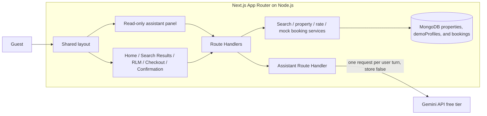
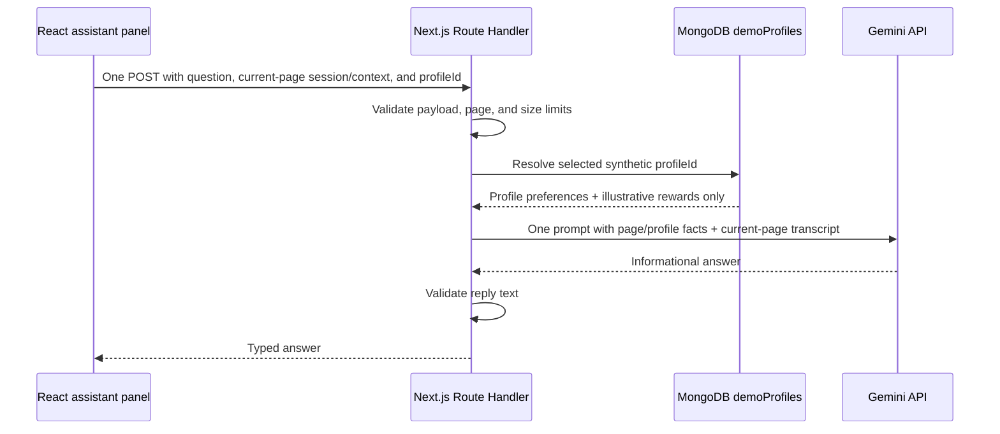

# System Design: Page-Aware Hotel Booking Assistant

## 1. Purpose and scope

Design a standalone fictional hotel booking site using **Next.js App Router, React, TypeScript, Node.js Route Handlers, MongoDB, synthetic data, and Gemini API free tier**.

The guest journey is Home → Search Results → Rate List Menu (RLM) → Checkout → Confirmation. A visible selector switches between fictional demo guest profiles and makes clear which profile informs suggestions. The assistant is informational and read-only; it cannot edit search criteria, filters, property/rate selections, or submit a booking. Mongo-backed Search/Rates grounding is deferred to V3, so the assistant must not answer those page-specific facts from stale local fixtures before then. Each page starts a fresh chat thread; the website carries booking selections and selected profile separately as needed.

## 2. System design goals

- Shared assistant UI across all routes, with a fresh transcript after each route change.
- One browser request and one Gemini request per user chat turn.
- Current-page context is limited to approved synthetic facts; Mongo grounding for live Search/Rates data is deferred to V3. No Gemini function calling or agent loop.
- Search and rate facts come from the Mongo-backed API responses; checkout and booking re-read the selected synthetic rate on the server. Assistant access to those canonical records is deferred to V3.
- Normal website controls own search, selection, and booking actions.
- AI failure never blocks the core search and mock booking journey.
- No production data, Marriott systems, real payment, or paid AI fallback.

## 3. Container and component view

Next.js App Router supplies file-based page routes, shared layouts, client navigation, and Node.js Route Handlers. No separate Express server or paid tool library is required. The shared layout can retain the sidebar UI while the assistant component resets its transcript whenever the active route changes.

Build the UI with Atomic Design: atoms (buttons, text fields, badges), molecules (form fields, prompt chips, price breakdowns), organisms (search form, assistant panel, result list, checkout summary), then templates/pages. Keep API and booking logic in feature hooks/services; presentation atoms and molecules remain reusable.

## 4. Chat request lifecycle

1. Guest submits a question on the current page.
2. React sends one `POST /api/v1/assistant/turn` request with `pageSessionId`, current page, selected synthetic `profileId`, a bounded transcript from this page only, the new message, and compact synthetic page context.
3. The Route Handler validates the schema and limits, resolves the profile from MongoDB, includes only profile preferences and illustrative rewards, and strips contact fields.
4. The Route Handler builds one prompt with current-page facts, the selected profile facts, and the page-local transcript, then sends one request to Gemini Interactions with `store: false` and no tools.
5. Server validates the text response and returns it with a request ID.
6. React displays the response. It does not interpret text as an action or alter the page.

The UI cannot see whether Gemini needed any internal processing; this project chooses a simple single model call and sends only the synthetic facts visible on the current page. Amazon's visible UI alone does not reveal how its backend is implemented, so this design follows the interaction pattern without claiming to match Amazon's internals.

## 5. Page routing and assistant reset

Suggested Next.js App Router paths:

| Page | Route |
|---|---|
| Home | `/` |
| Search Results | `/search` |
| RLM | `/property/[propertyId]/rates` |
| Checkout | `/checkout` |
| Confirmation | `/confirmation/[code]` |

Use a shared `app/layout.tsx` for the persistent site shell and assistant panel. The assistant panel is a client component. Observe the active route (for example, with Next navigation hooks) and create a new `pageSessionId`, clear the transcript/pending UI state, and refresh suggested prompts when the route or selected demo profile changes. Booking state is stored separately and remains only as long as required for the site flow.

## 6. Page data flows

### Home and Search Results

- Home stores the search criteria in the URL/browser state.
- Search Results sends criteria to `POST /api/v1/searches`; the Route Handler validates the criteria and reads matching synthetic properties from MongoDB.
- Search Results displays the paginated API response. Assistant property grounding is deferred to V3; it does not fall back to the old local property fixtures.
- Assistant does not populate or submit the form, apply filters, or change the result selection.

### RLM and Checkout

- Normal page navigation follows the guest's property choice.
- RLM requests `GET /api/v1/properties/{propertyId}/rates` with stay criteria; the Route Handler loads that property's embedded room/rate plans from MongoDB and calculates totals.
- The Rates UI renders only the API response. Assistant grounding for these Mongo rates is deferred to V3; it does not use local rate fixtures.
- Checkout reads the selected property/room/rate from the same server repository and shows a criteria-specific quote.

### Checkout and Confirmation

- The guest submits the ordinary checkout form.
- Booking Route Handler validates IDs and criteria, re-reads the selected Mongo rate, recalculates the same quote, and creates a synthetic confirmation; it does not process payment or call a real booking provider.
- Confirmation page loads the returned confirmation data; its assistant chat starts fresh and can explain only that synthetic confirmation.

## 7. State ownership

| Data | Owner | Behavior |
|---|---|---|
| Assistant transcript | React assistant panel | Current page and selected profile only; clear on route or profile change |
| `pageSessionId` | React assistant panel | New ID on each route/profile session |
| Search destination | Booking form and URL | Browser-only navigation state; never stored in Mongo or sent in Checkout/Confirmation assistant context |
| Search dates and guest counts | Booking form/store | Retain through the booking flow as needed; snapshot dates/counts with synthetic booking |
| Selected property, room, rate | Page controls and booking store | Change only through standard guest controls |
| Selected `profileId` | Shared booking/site state | Visible in the profile selector; retained across route changes; only the ID is sent from the browser |
| Current page context | Page context builder | Send only allowlisted IDs/values relevant to current question |
| Hotel catalog | MongoDB `properties` collection | Read-only synthetic documents |
| Demo profiles | MongoDB `demoProfiles` collection | Fictional contact, preferences, and clearly illustrative rewards |
| Mock bookings | MongoDB `bookings` collection | Mock confirmation with profile ID and synthetic contact snapshot |
| Gemini request | Server-side assistant service | One call per user turn; no transcript persistence |

Do not link chat sessions across pages or persist chat messages in the database. Carrying booking choices is not carrying conversational context.

## 8. Failure behavior

- Gemini quota exhausted or service unavailable: assistant reports a temporary issue; search and checkout pages remain usable.
- Treat current-page facts and the selected synthetic profile's allowlisted facts as authorized sources. Answer when a requested fact appears in either source; use the cannot-confirm fallback only when it is absent from both, and do not infer from general knowledge.
- Empty search results: show the normal empty state and allow the guest to edit search controls.
- Unknown property/rate/confirmation ID: return a typed not-found response; never ask the model to guess.
- Mock booking request fails: no confirmation is created; preserve checkout state and allow retry.

## 9. Cost, privacy, and security

- Only use a Gemini model that is currently included in free tier; do not attach paid billing or configure a paid fallback.
- Keep `GEMINI_API_KEY` server-side and out of all `NEXT_PUBLIC_*` variables and source control.
- Use `gemini-3.5-flash-lite` through the Interactions API with `store: false` and no tools. It is the currently verified free-tier demo model, but Google has deprecated it without a shutdown date; replace it with a supported free-tier model after verifying access and response behavior.
- Send only synthetic catalog facts and test-created chat prompts. Google's free-tier inputs/outputs may be used to improve products.
- Limit current-page history, message length, context size, and requests per turn to stay within free quotas.
- No Gemini function calling, built-in search/maps, browser tools, or other potentially metered services.
- Treat model output as display text only; never execute embedded instructions or map prose to UI actions.

## 10. Implementation decisions

- Use Next.js App Router and TypeScript; select the current supported Next.js version when scaffolding.
- Use Route Handlers in Node runtime for backend API endpoints and Gemini access.
- Seed MongoDB with synthetic properties and rates; persist mock bookings in MongoDB.
- Use an Atlas Free cluster or local MongoDB Community Server; see the database design for current constraints.
- Keep the selected Gemini model ID in server configuration and verify free-tier availability during setup.
